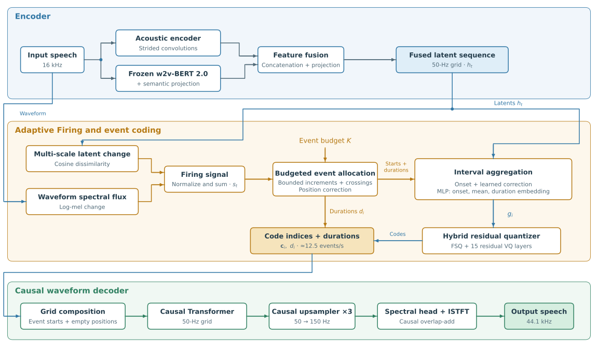

# RubatoCodec: Budgeted Adaptive Speech Tokenization with Streaming Decoding

[](https://huggingface.co/third-intelligence/RubatoCodec)
[](https://arxiv.org/abs/2610.29434)

RubatoCodec is a neural speech codec that adaptively allocates variable-duration
events under an exact utterance-level event budget and supports streaming waveform
decoding. Each event contains discrete code indices and a duration. The released model represents
speech at approximately **12.5 events/s**, with 16-kHz input and 44.1-kHz
output from a causal streaming decoder.

- **Adaptive Firing**: multi-scale latent dissimilarity and waveform spectral
  flux guide cumulative allocation on a 50-Hz latent grid. For `T` frames,
  the event count is exactly `max(1, min(T, round(target_ratio · T)))`, with
  `target_ratio=0.25` by default. No separate boundary predictor, boundary
  labels, or rate loss is required.
- **Streaming synthesis**: decode one event or a chunk of events incrementally.
  Decoding takes about 11 ms per event on an H200, well below the ~80 ms of
  audio each event represents.
- **16-layer hybrid residual quantizer**: an FSQ first layer with semantic
  supervision, followed by 15 DAC-style residual VQ layers. Each layer has
  4,096 indices. Any prefix depth from 1 to 16 can be decoded, giving nominal
  code-index bitrates of 150–2,400 bit/s plus duration information.



## Documentation

| Document | Contents |
|---|---|
| [docs/architecture.md](docs/architecture.md) | Full architecture: encoder, Adaptive Firing, quantizer, decoder, code format, bitrate, causality. |
| [docs/inference.md](docs/inference.md) | Loading, encode/decode, streaming API and inference settings. |
| [docs/training.md](docs/training.md) | Training stack, data, losses, phase schedule, launch commands. |
| [docs/config_reference.md](docs/config_reference.md) | Configuration keys and shipped defaults. |
| [docs/evaluation.md](docs/evaluation.md) | Evaluation workflow, results on five datasets, baseline comparisons, and throughput. |

## Installation

With [uv](https://docs.astral.sh/uv/):

```bash
uv sync                # inference only
uv sync --extra train  # + training stack (Lightning + Hydra)
uv sync --extra eval   # + evaluation metrics
```

## Quick start

```python
import soundfile as sf
import torch

from rubatocodec import RubatoCodec

codec = RubatoCodec.from_pretrained("third-intelligence/RubatoCodec", device="cuda")
# or: RubatoCodec.from_checkpoint("path/to/model.safetensors", device="cuda")

data, sr = sf.read("speech.wav", dtype="float32")  # mono waveform
wav = torch.from_numpy(data)

enc = codec.encode(wav, sr=sr)  # {"codes": (16, K) int64, "durs": (K,) int64}
audio = codec.decode(enc)  # (1, 1, T_audio) at 44.1 kHz, full depth
audio = codec.decode(enc, depth=8)  # bitrate control via residual depth

sf.write("recon.wav", audio[0, 0].cpu().numpy(), codec.output_sr)
```

Streaming decode:

```python
codes, durs = enc["codes"], enc["durs"]
out = []
for i in range(codes.shape[1]):
    chunk = codec.decode_streaming(
        codes[:, i : i + 1],
        "session-0",
        durs=durs[i : i + 1],
        finish=(i == codes.shape[1] - 1),
    )
    if chunk is not None:
        out.append(chunk)
audio = torch.cat(out, dim=2)
```

See [docs/inference.md](docs/inference.md) for details.

## Model summary

| | |
|---|---|
| Input / output sample rate | 16 kHz / 44.1 kHz |
| Latent grid | 50 Hz (320-sample hop size) |
| Nominal event rate | ≈12.5 events/s (`target_ratio` 0.25) |
| Quantizer | 16 layers × 4,096 (12 bits); layer 0 semantically distilled FSQ, layers 1–15 DAC-style VQ |
| Bitrate | Code indices: 150–2,400 bit/s (depths 1–16), plus duration information |
| Decoder | Fully causal (streaming) |
| Parameters | 72 M encoder / 173 M decoder / 1 M quantizer (246 M total; + frozen w2v-BERT 2.0 for encoding) |

## Evaluation

The released model is evaluated on LibriSpeech test-clean, VCTK, JVS, JVNV,
and seed-tts-eval test-zh. At depths 8 and 16, its estimated
bitrate is approximately 1.23 and 2.43 kbit/s, including timing information.
Among the compared codecs, RubatoCodec shows the best intelligibility
preservation on the English and Japanese benchmarks at comparable bitrates,
with high predicted quality, while the strongest comparators retain higher
PESQ-WB and STOI. The tables below show a subset of the compared codecs. Within
each bitrate band, **bold** marks the best and <ins>underline</ins> the second-best
score among the displayed codecs.

**LibriSpeech test-clean (English)**

| Codec | Event rate (Hz) | Bitrate (kbit/s) | UTMOSv2 ↑ | DNSMOS ↑ | PESQ-WB ↑ | STOI ↑ | dWER (%) ↓ | SIM ↑ |
|---|---:|---:|---:|---:|---:|---:|---:|---:|
| *Lower bitrate band* | | | | | | | | |
| FlexiCodec, τ=1, depth 8 | 12.5 | 1.24 | 3.194 | 3.284 | 2.813 | 0.940 | <ins>0.83</ins> | 0.846 |
| MiMo-Audio-Tokenizer, depth 6 | 25.0 | 1.20 | 3.183 | 3.291 | 2.677 | 0.927 | 0.86 | 0.848 |
| MOSS-Audio-Tokenizer, depth 10 | 12.5 | 1.25 | 3.230 | 3.217 | **3.052** | **0.949** | 0.89 | **0.904** |
| DTM-Codec, 80-Hz target | 81.5 | 1.28 | <ins>3.421</ins> | **3.334** | <ins>2.971</ins> | <ins>0.947</ins> | 1.41 | <ins>0.871</ins> |
| **RubatoCodec, depth 8** | 12.5 | 1.23 | **3.478** | <ins>3.327</ins> | 2.684 | 0.931 | **0.75** | <ins>0.871</ins> |
| *Higher bitrate band* | | | | | | | | |
| Qwen3-TTS-Tokenizer-12Hz | 12.5 | 2.20 | 3.230 | 3.273 | <ins>3.177</ins> | <ins>0.958</ins> | <ins>0.53</ins> | <ins>0.941</ins> |
| MiMo-Audio-Tokenizer, depth 13 | 25.0 | 2.42 | 3.210 | <ins>3.288</ins> | 3.094 | 0.947 | 0.67 | 0.896 |
| MOSS-Audio-Tokenizer, depth 20 | 12.5 | 2.50 | <ins>3.239</ins> | 3.203 | **3.536** | **0.968** | 0.62 | **0.954** |
| **RubatoCodec, depth 16** | 12.5 | 2.43 | **3.486** | **3.314** | 3.029 | 0.950 | **0.50** | 0.928 |

**JVNV (Japanese)**

| Codec | Event rate (Hz) | Bitrate (kbit/s) | UTMOSv2 ↑ | DNSMOS ↑ | PESQ-WB ↑ | STOI ↑ | dCER (%) ↓ | SIM ↑ |
|---|---:|---:|---:|---:|---:|---:|---:|---:|
| *Lower bitrate band* | | | | | | | | |
| FlexiCodec, τ=1, depth 8 | 12.5 | 1.24 | 1.811 | 3.128 | 2.062 | 0.862 | 5.52 | 0.786 |
| MiMo-Audio-Tokenizer, depth 6 | 25.0 | 1.20 | **2.681** | **3.173** | 2.295 | 0.872 | 7.88 | 0.821 |
| MOSS-Audio-Tokenizer, depth 10 | 12.5 | 1.25 | 2.396 | 3.089 | **3.032** | **0.917** | <ins>5.44</ins> | **0.924** |
| DTM-Codec, 80-Hz target | 46.1 | 0.77 | 2.523 | 3.154 | 2.081 | 0.862 | 14.82 | 0.783 |
| **RubatoCodec, depth 8** | 12.5 | 1.23 | <ins>2.628</ins> | <ins>3.164</ins> | <ins>2.650</ins> | <ins>0.907</ins> | **1.92** | <ins>0.907</ins> |
| *Higher bitrate band* | | | | | | | | |
| Qwen3-TTS-Tokenizer-12Hz | 12.5 | 2.20 | 2.638 | 3.097 | <ins>3.041</ins> | <ins>0.931</ins> | <ins>3.01</ins> | <ins>0.951</ins> |
| MiMo-Audio-Tokenizer, depth 13 | 25.0 | 2.42 | **2.708** | **3.176** | 2.949 | 0.911 | 4.21 | 0.885 |
| MOSS-Audio-Tokenizer, depth 20 | 12.5 | 2.50 | 2.383 | 3.057 | **3.496** | **0.941** | 3.96 | **0.963** |
| **RubatoCodec, depth 16** | 12.5 | 2.43 | <ins>2.651</ins> | <ins>3.138</ins> | 3.032 | 0.929 | **1.54** | 0.946 |

See [docs/evaluation.md](docs/evaluation.md#benchmark-results) for the protocol, all compared
codecs, VCTK, JVS, and Mandarin results, and H200 throughput measurements.

## Repository layout

```
rubatocodec/               public inference API, checkpoint settings, and firing
rubatocodec/modules/       encoder, decoder, attention, and semantic components
rubatocodec/quantization/  hybrid residual quantizer and DAC VQ layers
training/                 PyTorch Lightning + Hydra training stack and schedules
eval/                     objective evaluation metrics (UTMOS, DNSMOS, PESQ, ...)
examples/                 audio reconstruction example
scripts/                  checkpoint conversion (Lightning -> safetensors)
docs/                     architecture, usage, and configuration documentation
incl_licenses/            licenses of derived / vendored third-party code
```

## Citation

```bibtex
@misc{arata2026rubatocodecbudgetedadaptivespeech,
      title={RubatoCodec: Budgeted Adaptive Speech Tokenization with Streaming Decoding},
      author={Chihiro Arata and Shohei Taniguchi and Gouki Minegishi and Kan Hatakeyama-Sato},
      year={2026},
      eprint={2610.29434},
      archivePrefix={arXiv},
      primaryClass={cs.SD},
      url={https://arxiv.org/abs/2610.29434},
}
```

## Acknowledgements

- This codebase is derived from
  [X-Codec-2.0](https://github.com/zhenye234/X-Codec-2.0) (MIT).
- The MPD and MS-STFT discriminators are adapted from
  [BigCodec](https://github.com/Aria-K-Alethia/BigCodec) (MIT), via X-Codec-2.0.
- The semantic encoder uses
  [facebook/w2v-bert-2.0](https://huggingface.co/facebook/w2v-bert-2.0) (MIT).
- The residual VQ layers follow the design of
  [Descript Audio Codec (DAC)](https://github.com/descriptinc/descript-audio-codec)
  (MIT).
- The decoder upsampler blocks follow the design of
  [Inworld TTS](https://github.com/inworld-ai/tts) (MIT).
- Additional vendored components:
  SnakeBeta from [BigVGAN](https://github.com/NVIDIA/BigVGAN) (MIT), based on
  [snake activation](https://github.com/EdwardDixon/snake) (MIT),
  [alias-free-torch](https://github.com/junjun3518/alias-free-torch) (Apache 2.0),
  and filter code from [julius](https://github.com/adefossez/julius) (MIT).
- The latent dissimilarity signal is inspired by the boundary detector of
  [H-Net](https://arxiv.org/abs/2507.07955).

## License

Apache 2.0 — see [LICENSE](LICENSE). Third-party components retain their
respective licenses; see [`incl_licenses/`](incl_licenses/).
