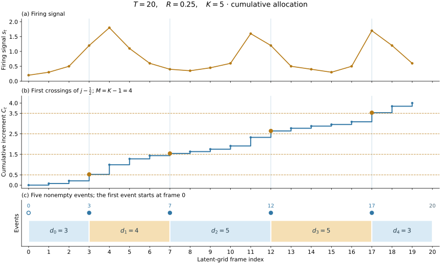

# RubatoCodec Architecture

RubatoCodec is a variable-frame-rate neural speech codec built on
[X-Codec-2](https://github.com/zhenye234/X-Codec-2.0). It separates the number
of events from their placement: each utterance has a prescribed event count,
while a firing signal determines where events begin. An event spans a nonempty
interval of the 50-Hz latent grid and is represented by quantizer indices and
its duration in grid frames. The released model uses approximately 12.5 events/s
and a causal decoder that supports incremental synthesis of 44.1-kHz audio.

The acoustic and semantic encoders, feature fusion, semantic reconstruction
pathway, and Transformer synthesis backbone follow X-Codec-2. Adaptive Firing,
interval aggregation, hybrid residual quantization, and duration-aware grid
reconstruction form the temporal bottleneck. A factor-three upsampler raises
the synthesis feature rate.

This document describes the released model architecture, also specified in
`training/config/model/default.yaml`.

## Overview


Signal path summary:

| Stage | Rate | Shape (single utterance) |
|---|---|---|
| Input waveform | 16 kHz | `(T_samples,)` |
| Acoustic encoder output | 50 Hz | `(T, 1024)` |
| Semantic branch output | 50 Hz | `(T, 1024)` |
| Fused latent `h_t` (after `fc_prior`) | 50 Hz | `(T, 2048)` |
| Event vectors (after interval aggregation) | ≈ 12.5 events/s | `(K, 2048)` |
| Codes | ≈ 12.5 events/s | `codes (16, K)`, `durs (K,)` |
| Composed grid (decoder input) | 50 Hz | `(T, 2048)` → `fc_post_a` → `(T, 1024)` |
| Upsampled features | 150 Hz | `(3T, 1024)` |
| Output waveform | 44.1 kHz | `(882·T,)` |

`T` = number of 50 Hz grid frames, `K` = number of events
(`sum(durs) = T`, `K = max(1, min(T, round(0.25 · T)))`).

## Encoder side

The encoder design follows
[X-Codec-2.0](https://github.com/zhenye234/X-Codec-2.0): an acoustic
convolutional encoder and
a frozen w2v-BERT 2.0 semantic branch, fused into one latent sequence.

### Acoustic encoder

A strided convolutional encoder
(`rubatocodec/modules/encoder.py`): base width `ngf=48`, downsampling ratios
`[2, 2, 4, 4, 5]` (total hop size 320 → 50 Hz at 16 kHz input), residual units with
dilations `[1, 3, 9]`, snake-beta activations, output dimension 1024.

### Semantic branch

A frozen [w2v-BERT 2.0](https://huggingface.co/facebook/w2v-bert-2.0) model
provides semantic features: the hidden states of layer 16 are projected by a
small convolutional `SemanticEncoder` to 1024 dimensions at the same 50 Hz
rate.

### Latent fusion

The acoustic (1024-d) and semantic (1024-d) streams are concatenated and
projected by `fc_prior` (Linear 2048 → 2048) to the latent sequence `h_t`
on the 50 Hz grid.

## Adaptive Firing

The firing module (`rubatocodec/firing.py`) partitions the latent grid into
events. A separate interval aggregator combines the frame features within
each event into one vector for quantization. The firing signal determines
boundaries; it does not weight the pooled features.

### Firing signal

The firing signal combines multi-scale latent dissimilarity and log-mel
spectral flux:

```math
s_t = s_t^{\mathrm{latent}} + \mathcal N(f)_t,
\qquad \mathcal N(v)_t = \frac{v_t}{\max(10^{-8}, T^{-1}\sum_u v_u)}.
```

**Multi-scale latent dissimilarity** compares fused features at offset pairs
$`\mathcal O=\{(1,0),(1,1),(2,1)\}`$:

```math
\ell_t^{a,b}=\max(0,1-\cos(h_{t-a},h_{t+b})),\qquad
s_t^{\mathrm{latent}}=\mathcal N\!\left(\sum_{(a,b)\in\mathcal O}\mathcal N(\ell^{a,b})\right)_t.
```

Unavailable edge comparisons are zero. This component follows the use of
feature dissimilarity for dynamic chunking in
[H-Net](https://arxiv.org/abs/2507.07955).

**Log-mel spectral flux** measures changes in the input waveform:

```math
f_t=\frac{1}{80}\sum_{m=1}^{80}\left|\log(M_{m,t}+10^{-5})-\log(M_{m,t-1}+10^{-5})\right|.
```

The mel spectrogram uses 80 bins, a 1,024-point centered STFT with reflection
padding, and a hop size of 320 samples at 16 kHz. The first flux value and
last two values are zeroed, then the sequence is truncated or zero-padded on
the right to match the latent grid.

Mean normalization makes the combination depend on the relative temporal
distributions of the two components rather than their raw scales. Neither requires a learned signal predictor or boundary labels.
The latent component includes frozen w2v-BERT features; waveform flux is
available before the acoustic encoder learns useful features.

### Cumulative allocation

For a sequence of $T$ grid frames the event budget is
$`K = \max(1, \min(T, \mathrm{round}(R \cdot T)))`$, where $R$ is `target_ratio` (0.25 in the
default configuration, giving the ≈12.5 events/s average on the 50 Hz grid).
Here, $\mathrm{round}$ rounds half to even.
The first frame always fires and is counted in the budget; the remaining
$`K - 1`$ firings are allocated over $`t \ge 1`$ using bounded increments:

```math
\delta_t = \min(\alpha s_t,\; 1), \qquad \alpha \ \text{such that}\ \sum_{t \ge 1} \delta_t = K - 1 \ \text{(found by bisection)},
```

and the $j$-th firing is placed at the first frame whose cumulative sum
$`C_t = \sum_{1 \le u \le t} \delta_u`$ reaches the half-integer threshold
$`j - 1/2`$ ($`j = 1, \dots, K-1`$); the bounded increment $`\delta_t \le 1`$
prevents more than one threshold crossing per grid frame in the regular case.
When the firing signal is negligible, uniform increments are used. If the target sum is
infeasible or numerical ties occur, a monotone position correction separates
coincident starts and reserves room for the remaining events. Together with
the initial event, this guarantees exactly $K$ distinct starts and nonempty
events, including the $K=1$ case.

Cumulative threshold crossing follows the integrate-and-fire principle used in
[CIF](https://arxiv.org/abs/1905.11235). RubatoCodec uses deterministic change
statistics to place hard event boundaries, followed by separate interval
aggregation. There is no maximum interval duration: low-change regions can form
long events, while high-change regions can receive multiple events on
successive frames.

The decision is deterministic and non-differentiable. Reconstruction and
representation losses train the encoder and aggregator through the selected
representations, and boundaries evolve during training as the features change.
Waveform flux provides a signal from the first training step, allowing the
trainable codec components to be optimized jointly from scratch while the
pretrained semantic feature extractor remains frozen.



### Interval aggregation

Event $i$ spans $`[p_i,p_{i+1})`$, where $`p_0=0`$, $`p_K=T`$, and
$`d_i=p_{i+1}-p_i`$. Every grid frame belongs to exactly one event.
The interval aggregator forms the quantizer input from the onset feature,
the mean of the frame features within the event, and a duration embedding:

```math
\bar h_i=\frac{1}{d_i}\sum_{t=p_i}^{p_{i+1}-1}h_t,\qquad
g_i=h_{p_i}+\mathrm{MLP}\!\left([h_{p_i};\bar h_i;E_d(\min(d_i,64))]\right).
```

The residual connection from the onset feature retains information at the
event start, while the learned correction incorporates the mean and duration. The embedding index saturates
at 64; the actual event duration is not capped.

## Hybrid residual quantizer

`RubatoResidualQuantizer` (`rubatocodec/quantization/residual.py`) quantizes each
event vector with 16 layers:

- **Layer 0**: finite scalar quantization (FSQ) with levels `[8, 8, 8, 8]`,
  yielding 4,096 indices.
- **Layers 1–15**: [DAC](https://github.com/descriptinc/descript-audio-codec)-style
  vector quantizers (4,096 entries each; factorized
  8-d codebook with L2-normalized lookup, gradient-learned codebook,
  commitment 0.25 / codebook 1.0 loss weights; vendored in
  `rubatocodec/quantization/dac.py`).

Training uses DAC-style quantizer dropout (`quantize_dropout: 1.0`: every
sample draws a depth uniformly from {1..16}), so at inference any prefix depth
`1 ≤ depth ≤ 16` produces a valid reconstruction; bitrate is controlled by
truncating the code layers. The residual chain runs in fp32 regardless
of the autocast setting to avoid cancellation error in deep layers.

### Semantic distillation

A training-only semantic head encourages the first quantizer layer to preserve
linguistic information for downstream speech generation. The objective follows
X-Codec-2's semantic reconstruction pathway. It shares the motivation of
[Mimi](https://arxiv.org/abs/2410.00037), but uses a serial residual chain rather
than parallel semantic and acoustic quantizers.

First-layer reconstructions are placed on the sparse 50-Hz grid described
below, with the same offset embeddings as the waveform decoder. Durations
set their grid positions; the head receives no separate duration embedding.
A 2,048-to-1,024 linear projection and four residual convolutional layers
(kernel size three, symmetric padding) predict the frozen layer-16 w2v-BERT
features before the encoder's semantic projection. The head can access four
grid frames on either side, including neighboring events within that range.

Mean squared error, normalized by feature dimension and the number of event
starts, is evaluated only at those starts. Each event thus receives one
teacher target where its first-layer representation enters the grid.

## Code format and bitrate

An encoded utterance is:

- `codes`: `(Q=16, K)` int64, quantizer indices per event in temporal order;
  layer 0 receives semantic supervision;
- `durs`: `(K,)` int64, duration of each event in 50 Hz grid frames;
  `pos_0 = 0`, `pos_i = Σ_{j<i} dur_j`, `Σ durs = T`, every `dur ≥ 1`.

With 12 bits per layer and an average of ≈12.5 events/s, the code payload is
`12 · depth · 12.5` bit/s on average. Duration information is additional:

| Depth | Code bits/event | Nominal code-index bitrate |
|---|---|---|
| 16 (full) | 192 | 2,400 bit/s |
| 8 | 96 | 1,200 bit/s |
| 4 | 48 | 600 bit/s |
| 1 (first layer only) | 12 | 150 bit/s |

The [evaluation tables](evaluation.md#reconstruction-results) include timing costs estimated from the
empirical entropy of event durations.
For $K$ events over $T$ grid frames, the per-utterance estimate is
$`(12 \cdot \mathrm{depth} \cdot K + K H(d))/(T/50)`$ bit/s, where
$H(d)$ is the dataset-pooled duration entropy in bits per event. Dataset rates
are arithmetic means of these per-utterance estimates. The in-memory int64
arrays are an API representation, not an entropy-coded serialization.

## Decoder side

### Grid composition

The decoder first re-expands the event sequence onto the 50 Hz grid
(`grid_compose: empty`): the dequantized event vector is placed at its firing
position (plus the offset embedding at offset 0); every subsequent frame of
the event is a learned "empty" embedding plus the offset embedding of its
distance from the firing (saturating at `max_gap = 64`). Because each event's
duration is part of the code, this expansion is causal: frame `t` depends only
on events starting at or before `t`. The offset embedding identifies each frame
within its event, and the decoder can attend to the onset feature to synthesize
the event's audio.

### Transformer backbone

The backbone follows the X-Codec-2.0 decoder, made fully causal
(`VocosBackbone` in
`rubatocodec/modules/decoder.py`), and operates at 50 Hz: `fc_post_a`
(Linear 2048 → 1024), an embedding conv (kernel 3, causal), 12 Transformer
layers (hidden 1024, 16 heads, rotary position embeddings, MLP expansion 4)
with causal attention, and convolutional ResNet blocks (kernel 1 in the
default configuration).

During inference, the decoder periodically discards its cached states and
rebuilds them from a window of recent events beginning at an event onset,
which limits long-utterance extrapolation. At each such history recomputation,
a short crossfade blends the audio decoded before and after the recomputation.
Streaming decoding reuses decoder states between history recomputations and
briefly buffers audio for the crossfade. The model's `config.json` supplies the decoding
defaults; see [inference.md](inference.md).

### Upsampler and ISTFT head

The 50 Hz features are upsampled ×3 to 150 Hz by a transposed-conv upsampler
block (kernel 9; block design follows
[Inworld TTS](https://github.com/inworld-ai/tts)), then converted to a
44.1 kHz waveform by an ISTFT head (`n_fft` 1176, hop size 294; 150 Hz × 294 =
44100): the features are projected to STFT magnitude and phase and the
waveform is synthesized by inverse STFT, following
[Vocos](https://arxiv.org/abs/2306.00814). One grid frame corresponds to
exactly 882 output samples (20 ms).

### Causality

Convolutions are left-padded, transposed convolutions are right-trimmed,
and attention excludes future frames. Each 1,176-sample ISTFT window starts
at the current synthesis frame's hop position and extends forward. Each frame
finalizes 294 samples and carries waveform and window-normalization overlap
buffers into the next frame. Three synthesis frames per grid step give
`882 · d_i` samples for an event of duration `d_i`.

At startup, normalization assumes preceding silent windows, producing a
20-ms fade-in. At termination, the remaining window overhang is discarded,
so the waveform contains exactly `882 · sum(durs)` samples.

## Parameter counts

Inference weights (excluding the frozen w2v-BERT 2.0): **246.1 M parameters**
split as:

| Component | Params |
|---|---|
| Encoder side (acoustic encoder 38.5 M, semantic projection 12.6 M, `fc_prior` 4.2 M, firing + interval aggregation 17.0 M) | 72.3 M |
| Decoder side (backbone 162.6 M, upsampler 6.8 M, ISTFT head 1.2 M, `fc_post_a` 2.1 M) | 172.7 M |
| Residual quantizer | 1.1 M |

The frozen w2v-BERT 2.0 (580 M parameters) is additionally required on the
encode side (and is downloaded from the Hugging Face Hub at load time).

## Training-time components

Not part of the released inference model (see [training.md](training.md)):

- **Discriminators**: HiFi-GAN multi-period discriminator (periods
  2, 3, 5, 7, 11, 17, 23, 37) and a multi-resolution STFT discriminator
  (8 resolutions).
- **Losses**: multi-resolution mel loss, adversarial + feature-matching losses,
  perceptual loss (wav2vec2-xls-r-300m layers 10–21), semantic distillation
  loss on the first layer (event starts only), VQ commitment/codebook losses.
