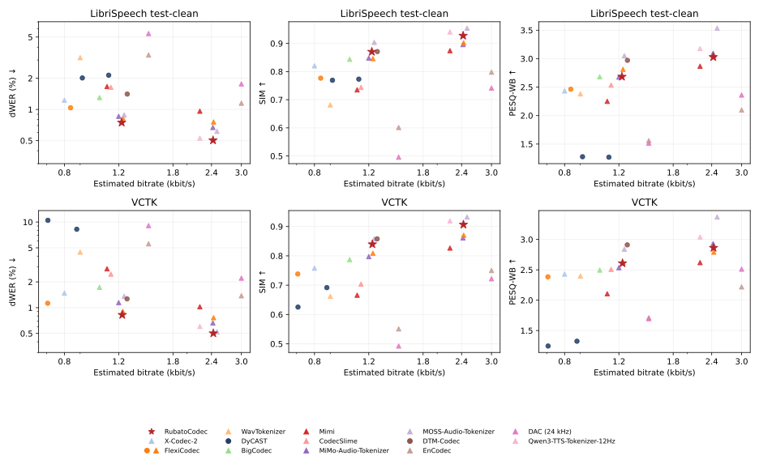
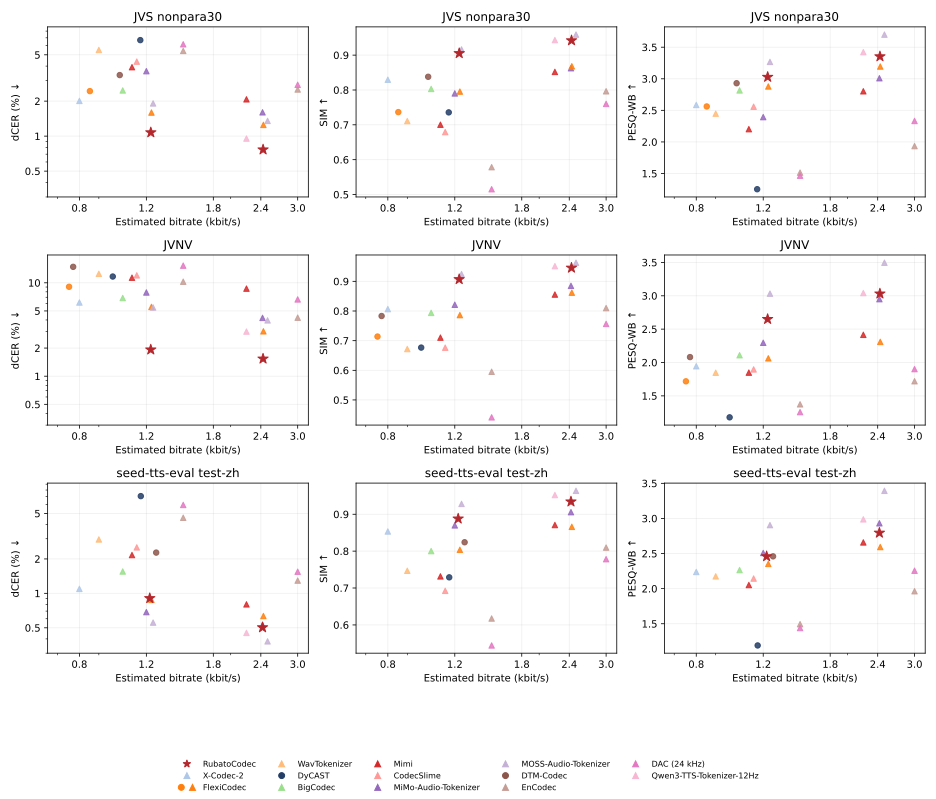

# Evaluation

This guide covers [running evaluation on your own audio](#running-evaluation)
and the released model's [benchmark results](#benchmark-results).

## Running evaluation

From a repository checkout, prepare an audio list, reconstruct it, then evaluate
the saved audio pairs. `depth` selects the number of active quantizer layers.

### 1. Prepare the input list

Create `manifest.json` listing the audio to reconstruct:

```json
{
  "samples": [
    {"audio": "speech/001.wav", "idx": "utterance-001", "text": "Hello world."},
    {"audio": "speech/002.flac"}
  ]
}
```

`audio` is required. `idx` is an optional unique integer or string (defaults to
the zero-based row number), and `text` is optional reference text.
Supply `text` for the reference-text recognition metrics (`ref_asr`, which
reports `cer`, `wer_norm`, and `cer_norm`); differential ASR metrics
(`dwer`/`dcer`) use the original audio instead.

### 2. Reconstruct the audio

Run from the repository root:

```bash
uv run python -m examples.reconstruct_dataset manifest.json eval_output/rubato_d8 \
    --depth 8 --device cuda
```

Use `--checkpoint path/to/model.safetensors` for local weights, or `--model` for
a Hub model ID. Add `--streaming` to decode one event at a time. The output
directory must be new or empty.

The script saves audio pairs and generates `metadata.json`, which records
which original and reconstructed files the evaluator should compare:

```text
eval_output/rubato_d8/
├── original/000000.wav
├── original/000001.wav
├── reconstructed/000000.wav
├── reconstructed/000001.wav
└── metadata.json
```

Audio pairs are saved as mono float WAV files: originals at their source sample
rate and reconstructions at `codec.output_sr`.

### 3. Evaluate the reconstructions

Pass the reconstruction output directory to the evaluator. It reads the generated
`metadata.json` and computes the selected metrics:

```bash
uv run --extra eval python -m eval.evaluate \
    --input-dir eval_output/rubato_d8 --metrics mel_distance --device cuda
```

Use `--metrics` to select comma-separated metrics, for example
`mel_distance,pesq,stoi`. Run `uv run --extra eval python -m eval.evaluate --help`
for CLI options, including ASR settings.

To compute the metrics reported in the benchmark tables below, select the
recognition model and language for each dataset:

```bash
# English (Whisper-large-v3 with Whisper's English normalizer; report dWER)
uv run --extra eval python -m eval.evaluate --input-dir eval_output/librispeech_d8 \
    --metrics utmosv2,dnsmos,pesq,stoi,dwer,speaker_sim_wavlm \
    --asr-language en \
    --speaker-wavlm-ckpt path/to/wavlm_large_finetune.pth \
    --unispeech-dir path/to/UniSpeech --device cuda

# Japanese (Whisper-large-v3 with basic normalization; report dCER)
uv run --extra eval python -m eval.evaluate --input-dir eval_output/jvs_d8 \
    --metrics utmosv2,dnsmos,pesq,stoi,dcer,speaker_sim_wavlm \
    --asr-language ja \
    --speaker-wavlm-ckpt path/to/wavlm_large_finetune.pth \
    --unispeech-dir path/to/UniSpeech --device cuda

# Mandarin (Paraformer-zh with seed-tts-eval normalization; report dCER)
uv run --extra eval python -m eval.evaluate --input-dir eval_output/mandarin_d8 \
    --metrics utmosv2,dnsmos,pesq,stoi,dcer,speaker_sim_wavlm \
    --asr-model paraformer-zh \
    --speaker-wavlm-ckpt path/to/wavlm_large_finetune.pth \
    --unispeech-dir path/to/UniSpeech --device cuda
```

Whisper's English normalizer is applied only with `--asr-language en`; other
languages use Whisper's basic normalization. Whisper inputs longer than
30 seconds are transcribed with long-form (timestamped) generation.

Scores are saved to `eval_output/rubato_d8/results.json`, with aggregate scores
in `summary` and individual utterance scores in `per_sample`.

## Benchmark results

We evaluate the released RubatoCodec model on English, Japanese, and Mandarin
Chinese at a nominal rate of 12.5 events/s and 44.1-kHz output.
Depth denotes the number of active quantizer layers.

### Datasets

| Dataset | Language | Utterances | Evaluation subset |
|---|---|---:|---|
| [LibriSpeech](https://www.openslr.org/12) | English | 2,620 | Full test-clean split |
| [VCTK 0.92](https://doi.org/10.7488/ds/2645) | English | 1,308 | Filtered mic1 recordings; 12 utterances per speaker |
| [JVS](https://sites.google.com/site/shinnosuketakamichi/research-topics/jvs_corpus) | Japanese | 3,000 | nonpara30: 30 utterances from each of 100 speakers |
| [JVNV](https://sites.google.com/site/shinnosuketakamichi/research-topics/jvnv_corpus) | Japanese | 1,615 | Full corpus: four speakers, six emotions, including nonverbal vocalizations |
| [seed-tts-eval](https://github.com/BytedanceSpeech/seed-tts-eval) | Mandarin Chinese | 2,020 | test-zh recordings |

VCTK uses silence-trimmed mic1 recordings with nonempty transcripts and
lengths of 1–40 seconds, sampling 12 utterances from each of 109 speakers.
The selected [utterance IDs](vctk_eval_ids.txt) identify files named
`<ID>_mic1.flac` in `wav48_silence_trimmed/<speaker>/`.
The ID list is an evaluation subset of VCTK 0.92 by Junichi Yamagishi,
Christophe Veaux, and Kirsten MacDonald (2019), distributed under
[CC BY 4.0](https://creativecommons.org/licenses/by/4.0/)
([source](https://doi.org/10.7488/ds/2645)).

### Metrics and rate accounting

Quality metrics use audio resampled to 16 kHz. Recognition error rates
(dWER and dCER) are micro-averaged within each dataset: total edit counts
are divided by total reference words or characters. Other quality scores
are averaged over utterances.

| Metric | Definition |
|---|---|
| UTMOSv2 ↑ | Reference-free speech-quality predictor. |
| DNSMOS ↑ | Reference-free overall-quality score (OVRL). |
| PESQ-WB ↑ | Wideband perceptual reconstruction quality. |
| STOI ↑ | Short-time objective intelligibility. |
| dWER / dCER (%) ↓ | Error rate between the ASR transcripts of reconstructed and original audio, using the original audio's ASR output as reference. |
| SIM ↑ | Cosine similarity of speaker embeddings from a fine-tuned WavLM-Large speaker verification model. |

SIM uses the [UniSpeech fine-tuned WavLM-Large speaker verification model](https://github.com/microsoft/UniSpeech/tree/main/downstreams/speaker_verification).
To compute it, select `speaker_sim_wavlm` and pass `--speaker-wavlm-ckpt`
(the released `wavlm_large_finetune.pth`) and `--unispeech-dir` (a local
UniSpeech checkout).

English and Japanese use Whisper-large-v3; Mandarin uses Paraformer-zh.
We apply Whisper's English normalization for English, basic normalization with
spaces removed for Japanese, and the seed-tts-eval normalization for Mandarin.
The tables report dWER for English and dCER for Japanese and Mandarin.
For PESQ and STOI, the resampled waveforms are trimmed to their common length
from the start, without delay correction or temporal warping.

Event rate and bitrate are computed per utterance using the duration represented
by the codec's temporal grid, then averaged within each dataset. Event rate is
the encoded event count divided by that duration; for fixed-rate codecs, each
frame counts as one event. Bitrate includes code indices and timing information.
Explicit timing symbols are charged at their dataset-pooled empirical entropy
per symbol. RubatoCodec includes all event durations; timing embedded in another
codec's indices is included in its code cost. See
[architecture.md](architecture.md#code-format-and-bitrate).

### Reconstruction results

Operating points are selected within 0.8–1.5 and 2.2–3.0 kbit/s on LibriSpeech;
the same codec configurations are used for VCTK. Tables separate lower- and
higher-bitrate operating points. GT denotes the original audio. Within each
band, **bold values** mark the best score and <ins>underlined values</ins> the second best,
excluding GT; ties at displayed precision share the same formatting.
**Adaptive** denotes content-dependent event placement or durations, and
**Fixed** denotes a fixed temporal grid.



*English reconstruction quality versus estimated bitrate on LibriSpeech test-clean
and VCTK. Stars denote RubatoCodec at depths 8 and 16; circles denote adaptive
allocation and triangles fixed allocation for the other codecs. Bitrate and dWER
axes are logarithmic.*

#### LibriSpeech test-clean (English)

##### Lower bitrate band

| Codec / configuration | Allocation | Event rate (Hz) | Bitrate (kbit/s) | UTMOSv2 ↑ | DNSMOS ↑ | PESQ-WB ↑ | STOI ↑ | dWER (%) ↓ | SIM ↑ |
|---|---|---|---|---|---|---|---|---|---|
| GT | — | — | — | 3.233 | 3.272 | 4.644 | 1.000 | 0.00 | 1.000 |
| X-Codec-2 | Fixed | 50.0 | 0.80 | 3.233 | 3.299 | 2.434 | 0.919 | 1.23 | 0.821 |
| FlexiCodec, τ=0.91, depth 8 | Adaptive | 8.3 | 0.84 | 3.174 | 3.307 | 2.463 | 0.919 | 1.04 | 0.777 |
| WavTokenizer, 75 Hz | Fixed | 75.0 | 0.90 | 2.772 | **3.342** | 2.382 | 0.912 | 3.16 | 0.682 |
| DyCAST, CA | Adaptive | 14.2 | 0.91 | 2.868 | 3.316 | 1.277 | 0.213 | 2.01 | 0.769 |
| BigCodec | Fixed | 80.0 | 1.04 | 3.362 | 3.333 | 2.681 | 0.935 | 1.30 | 0.844 |
| Mimi, depth 8 | Fixed | 12.5 | 1.10 | 2.810 | 3.159 | 2.251 | 0.906 | 1.67 | 0.735 |
| DyCAST, BP minimum gap 1 | Adaptive | 17.4 | 1.11 | 2.894 | 3.318 | 1.269 | 0.212 | 2.14 | 0.773 |
| CodecSlime, FSQ18K, 80 Hz | Fixed | 80.0 | 1.13 | 3.341 | 3.327 | 2.535 | 0.926 | 1.63 | 0.744 |
| MiMo-Audio-Tokenizer, depth 6 | Fixed | 25.0 | 1.20 | 3.183 | 3.291 | 2.677 | 0.927 | 0.86 | 0.848 |
| FlexiCodec, τ=1, depth 8 | Fixed | 12.5 | 1.24 | 3.194 | 3.284 | 2.813 | 0.940 | <ins>0.83</ins> | 0.846 |
| MOSS-Audio-Tokenizer, depth 10 | Fixed | 12.5 | 1.25 | 3.230 | 3.217 | **3.052** | **0.949** | 0.89 | **0.904** |
| DTM-Codec, 80-Hz target | Adaptive | 81.5 | 1.28 | <ins>3.421</ins> | <ins>3.334</ins> | <ins>2.971</ins> | <ins>0.947</ins> | 1.41 | <ins>0.871</ins> |
| EnCodec, 1.5 kbit/s | Fixed | 75.0 | 1.50 | 1.398 | 2.425 | 1.560 | 0.845 | 3.36 | 0.601 |
| DAC (24 kHz), depth 2 | Fixed | 75.0 | 1.50 | 1.413 | 2.717 | 1.515 | 0.836 | 5.40 | 0.496 |
| **RubatoCodec, depth 8** | Adaptive | 12.5 | 1.23 | **3.478** | 3.327 | 2.684 | 0.931 | **0.75** | <ins>0.871</ins> |

##### Higher bitrate band

| Codec / configuration | Allocation | Event rate (Hz) | Bitrate (kbit/s) | UTMOSv2 ↑ | DNSMOS ↑ | PESQ-WB ↑ | STOI ↑ | dWER (%) ↓ | SIM ↑ |
|---|---|---|---|---|---|---|---|---|---|
| Mimi, depth 16 | Fixed | 12.5 | 2.20 | 2.943 | 3.175 | 2.867 | 0.939 | 0.96 | 0.874 |
| Qwen3-TTS-Tokenizer-12Hz | Fixed | 12.5 | 2.20 | 3.230 | 3.273 | <ins>3.177</ins> | <ins>0.958</ins> | <ins>0.53</ins> | <ins>0.941</ins> |
| MiMo-Audio-Tokenizer, depth 13 | Fixed | 25.0 | 2.42 | 3.210 | <ins>3.288</ins> | 3.094 | 0.947 | 0.67 | 0.896 |
| FlexiCodec, τ=1, depth 16 | Fixed | 12.5 | 2.44 | 3.235 | 3.277 | 3.052 | 0.953 | 0.76 | 0.902 |
| MOSS-Audio-Tokenizer, depth 20 | Fixed | 12.5 | 2.50 | <ins>3.239</ins> | 3.203 | **3.536** | **0.968** | 0.62 | **0.954** |
| EnCodec, 3 kbit/s | Fixed | 75.0 | 3.00 | 1.786 | 2.765 | 2.098 | 0.900 | 1.15 | 0.798 |
| DAC (24 kHz), depth 4 | Fixed | 75.0 | 3.00 | 2.005 | 3.116 | 2.361 | 0.905 | 1.77 | 0.742 |
| **RubatoCodec, depth 16** | Adaptive | 12.5 | 2.43 | **3.486** | **3.314** | 3.029 | 0.950 | **0.50** | 0.928 |

#### VCTK (English)

##### Lower bitrate band

| Codec / configuration | Allocation | Event rate (Hz) | Bitrate (kbit/s) | UTMOSv2 ↑ | DNSMOS ↑ | PESQ-WB ↑ | STOI ↑ | dWER (%) ↓ | SIM ↑ |
|---|---|---|---|---|---|---|---|---|---|
| GT | — | — | — | 3.566 | 3.202 | 4.644 | 1.000 | 0.00 | 1.000 |
| FlexiCodec, τ=0.91, depth 8 | Adaptive | 7.0 | 0.71 | 3.354 | 3.191 | 2.384 | 0.846 | 1.13 | 0.738 |
| DyCAST, CA | Adaptive | 11.0 | 0.71 | 2.594 | 3.179 | 1.245 | 0.202 | 10.47 | 0.625 |
| X-Codec-2 | Fixed | 50.0 | 0.80 | 3.443 | 3.190 | 2.430 | 0.858 | 1.48 | 0.758 |
| DyCAST, BP minimum gap 1 | Adaptive | 13.6 | 0.88 | 2.805 | 3.226 | 1.324 | 0.242 | 8.24 | 0.692 |
| WavTokenizer, 75 Hz | Fixed | 75.0 | 0.90 | 3.198 | 3.208 | 2.397 | 0.853 | 4.45 | 0.662 |
| BigCodec | Fixed | 80.0 | 1.04 | 3.368 | **3.243** | 2.495 | 0.873 | 1.73 | 0.787 |
| Mimi, depth 8 | Fixed | 12.5 | 1.10 | 3.036 | 2.908 | 2.106 | 0.808 | 2.85 | 0.666 |
| CodecSlime, FSQ18K, 80 Hz | Fixed | 80.0 | 1.13 | 3.429 | 3.223 | 2.507 | 0.867 | 2.46 | 0.704 |
| MiMo-Audio-Tokenizer, depth 6 | Fixed | 25.0 | 1.20 | <ins>3.495</ins> | 3.087 | 2.535 | 0.875 | 1.15 | 0.798 |
| FlexiCodec, τ=1, depth 8 | Fixed | 12.5 | 1.24 | 3.357 | 3.166 | 2.622 | 0.879 | <ins>0.91</ins> | 0.809 |
| MOSS-Audio-Tokenizer, depth 10 | Fixed | 12.5 | 1.25 | 3.351 | 3.029 | <ins>2.840</ins> | <ins>0.885</ins> | 1.36 | **0.858** |
| DTM-Codec, 80-Hz target | Adaptive | 80.2 | 1.28 | 3.492 | 3.230 | **2.911** | **0.886** | 1.27 | **0.858** |
| EnCodec, 1.5 kbit/s | Fixed | 75.0 | 1.50 | 1.523 | 2.498 | 1.711 | 0.768 | 5.57 | 0.551 |
| DAC (24 kHz), depth 2 | Fixed | 75.0 | 1.50 | 1.620 | 2.930 | 1.696 | 0.808 | 9.08 | 0.493 |
| **RubatoCodec, depth 8** | Adaptive | 12.5 | 1.23 | **3.533** | <ins>3.235</ins> | 2.608 | 0.868 | **0.82** | <ins>0.840</ins> |

##### Higher bitrate band

| Codec / configuration | Allocation | Event rate (Hz) | Bitrate (kbit/s) | UTMOSv2 ↑ | DNSMOS ↑ | PESQ-WB ↑ | STOI ↑ | dWER (%) ↓ | SIM ↑ |
|---|---|---|---|---|---|---|---|---|---|
| Mimi, depth 16 | Fixed | 12.5 | 2.20 | 3.252 | 2.926 | 2.619 | 0.840 | 1.03 | 0.827 |
| Qwen3-TTS-Tokenizer-12Hz | Fixed | 12.5 | 2.20 | 3.494 | 3.107 | <ins>3.040</ins> | 0.900 | 0.60 | <ins>0.919</ins> |
| MiMo-Audio-Tokenizer, depth 13 | Fixed | 25.0 | 2.42 | <ins>3.501</ins> | 3.104 | 2.930 | <ins>0.901</ins> | 0.66 | 0.861 |
| FlexiCodec, τ=1, depth 16 | Fixed | 12.5 | 2.44 | 3.367 | <ins>3.168</ins> | 2.791 | 0.891 | 0.76 | 0.871 |
| MOSS-Audio-Tokenizer, depth 20 | Fixed | 12.5 | 2.50 | 3.392 | 3.009 | **3.370** | **0.917** | <ins>0.52</ins> | **0.932** |
| EnCodec, 3 kbit/s | Fixed | 75.0 | 3.00 | 1.981 | 2.790 | 2.219 | 0.813 | 1.38 | 0.750 |
| DAC (24 kHz), depth 4 | Fixed | 75.0 | 3.00 | 2.348 | 3.112 | 2.511 | 0.874 | 2.21 | 0.722 |
| **RubatoCodec, depth 16** | Adaptive | 12.5 | 2.43 | **3.524** | **3.222** | 2.863 | 0.886 | **0.50** | 0.907 |



*Japanese (JVS and JVNV) and Mandarin (seed-tts-eval test-zh) reconstruction quality
versus estimated bitrate. Markers follow the English figure; bitrate and dCER
axes are logarithmic.*

#### JVS nonpara30 (Japanese)

##### Lower bitrate band

| Codec / configuration | Allocation | Event rate (Hz) | Bitrate (kbit/s) | UTMOSv2 ↑ | DNSMOS ↑ | PESQ-WB ↑ | STOI ↑ | dCER (%) ↓ | SIM ↑ |
|---|---|---|---|---|---|---|---|---|---|
| GT | — | — | — | 3.621 | 3.334 | 4.644 | 0.999 | 0.00 | 1.000 |
| X-Codec-2 | Fixed | 50.0 | 0.80 | 3.234 | 3.312 | 2.585 | 0.924 | 2.01 | 0.829 |
| FlexiCodec, τ=0.91, depth 8 | Adaptive | 8.5 | 0.85 | 2.772 | 3.292 | 2.562 | 0.925 | 2.44 | 0.736 |
| WavTokenizer, 75 Hz | Fixed | 75.0 | 0.90 | 2.656 | 3.336 | 2.448 | 0.913 | 5.51 | 0.711 |
| DTM-Codec, 80-Hz target | Adaptive | 63.3 | 1.02 | <ins>3.275</ins> | <ins>3.354</ins> | 2.929 | 0.944 | 3.35 | 0.838 |
| BigCodec | Fixed | 80.0 | 1.04 | 3.244 | 3.348 | 2.816 | 0.938 | 2.47 | 0.803 |
| Mimi, depth 8 | Fixed | 12.5 | 1.10 | 2.686 | 3.096 | 2.202 | 0.904 | 3.91 | 0.700 |
| CodecSlime, FSQ18K, 80 Hz | Fixed | 80.0 | 1.13 | 3.185 | 3.345 | 2.557 | 0.923 | 4.37 | 0.679 |
| DyCAST, BP minimum gap 1 | Adaptive | 18.0 | 1.16 | 2.573 | 3.321 | 1.251 | 0.131 | 6.69 | 0.736 |
| MiMo-Audio-Tokenizer, depth 6 | Fixed | 25.0 | 1.20 | 3.171 | 3.304 | 2.393 | 0.906 | 3.62 | 0.790 |
| FlexiCodec, τ=1, depth 8 | Fixed | 12.5 | 1.24 | 2.802 | 3.276 | 2.878 | 0.939 | <ins>1.60</ins> | 0.795 |
| MOSS-Audio-Tokenizer, depth 10 | Fixed | 12.5 | 1.25 | 3.248 | 3.240 | **3.267** | **0.959** | 1.91 | **0.916** |
| EnCodec, 1.5 kbit/s | Fixed | 75.0 | 1.50 | 1.230 | 2.426 | 1.514 | 0.843 | 5.40 | 0.578 |
| DAC (24 kHz), depth 2 | Fixed | 75.0 | 1.50 | 1.204 | 2.821 | 1.465 | 0.834 | 6.16 | 0.515 |
| **RubatoCodec, depth 8** | Adaptive | 12.5 | 1.23 | **3.408** | **3.358** | <ins>3.028</ins> | <ins>0.949</ins> | **1.07** | <ins>0.905</ins> |

##### Higher bitrate band

| Codec / configuration | Allocation | Event rate (Hz) | Bitrate (kbit/s) | UTMOSv2 ↑ | DNSMOS ↑ | PESQ-WB ↑ | STOI ↑ | dCER (%) ↓ | SIM ↑ |
|---|---|---|---|---|---|---|---|---|---|
| Mimi, depth 16 | Fixed | 12.5 | 2.20 | 2.869 | 3.124 | 2.802 | 0.943 | 2.07 | 0.852 |
| Qwen3-TTS-Tokenizer-12Hz | Fixed | 12.5 | 2.20 | **3.434** | 3.275 | <ins>3.422</ins> | <ins>0.965</ins> | <ins>0.95</ins> | <ins>0.943</ins> |
| MiMo-Audio-Tokenizer, depth 13 | Fixed | 25.0 | 2.42 | 3.285 | <ins>3.317</ins> | 3.009 | 0.939 | 1.60 | 0.862 |
| FlexiCodec, τ=1, depth 16 | Fixed | 12.5 | 2.44 | 2.884 | 3.274 | 3.194 | 0.957 | 1.25 | 0.868 |
| MOSS-Audio-Tokenizer, depth 20 | Fixed | 12.5 | 2.50 | 3.249 | 3.224 | **3.700** | **0.976** | 1.35 | **0.959** |
| EnCodec, 3 kbit/s | Fixed | 75.0 | 3.00 | 1.575 | 2.763 | 1.934 | 0.898 | 2.52 | 0.796 |
| DAC (24 kHz), depth 4 | Fixed | 75.0 | 3.00 | 1.919 | 3.146 | 2.332 | 0.906 | 2.76 | 0.760 |
| **RubatoCodec, depth 16** | Adaptive | 12.5 | 2.43 | <ins>3.407</ins> | **3.349** | 3.353 | <ins>0.965</ins> | **0.77** | 0.942 |

#### JVNV (Japanese)

##### Lower bitrate band

| Codec / configuration | Allocation | Event rate (Hz) | Bitrate (kbit/s) | UTMOSv2 ↑ | DNSMOS ↑ | PESQ-WB ↑ | STOI ↑ | dCER (%) ↓ | SIM ↑ |
|---|---|---|---|---|---|---|---|---|---|
| GT | — | — | — | 2.526 | 3.098 | 4.644 | 1.000 | 0.00 | 1.000 |
| FlexiCodec, τ=0.91, depth 8 | Adaptive | 7.5 | 0.75 | 1.742 | 3.133 | 1.718 | 0.817 | 9.06 | 0.714 |
| DTM-Codec, 80-Hz target | Adaptive | 46.1 | 0.77 | 2.523 | 3.154 | 2.081 | 0.862 | 14.82 | 0.783 |
| X-Codec-2 | Fixed | 50.0 | 0.80 | 2.369 | 3.148 | 1.944 | 0.858 | 6.15 | 0.807 |
| WavTokenizer, 75 Hz | Fixed | 75.0 | 0.90 | 1.769 | 3.150 | 1.846 | 0.842 | 12.48 | 0.672 |
| DyCAST, BP minimum gap 1 | Adaptive | 15.3 | 0.98 | 1.797 | 3.071 | 1.178 | 0.156 | 11.67 | 0.677 |
| BigCodec | Fixed | 80.0 | 1.04 | 2.439 | 3.154 | 2.109 | 0.871 | 6.87 | 0.794 |
| Mimi, depth 8 | Fixed | 12.5 | 1.10 | 1.913 | 2.907 | 1.848 | 0.826 | 11.34 | 0.710 |
| CodecSlime, FSQ18K, 80 Hz | Fixed | 80.0 | 1.13 | 2.225 | 3.140 | 1.896 | 0.851 | 12.01 | 0.676 |
| MiMo-Audio-Tokenizer, depth 6 | Fixed | 25.0 | 1.20 | **2.681** | **3.173** | 2.295 | 0.872 | 7.88 | 0.821 |
| FlexiCodec, τ=1, depth 8 | Fixed | 12.5 | 1.24 | 1.811 | 3.128 | 2.062 | 0.862 | 5.52 | 0.786 |
| MOSS-Audio-Tokenizer, depth 10 | Fixed | 12.5 | 1.25 | 2.396 | 3.089 | **3.032** | **0.917** | <ins>5.44</ins> | **0.924** |
| EnCodec, 1.5 kbit/s | Fixed | 75.0 | 1.50 | 1.070 | 2.196 | 1.373 | 0.779 | 10.27 | 0.595 |
| DAC (24 kHz), depth 2 | Fixed | 75.0 | 1.50 | 0.860 | 2.520 | 1.256 | 0.759 | 15.26 | 0.441 |
| **RubatoCodec, depth 8** | Adaptive | 12.5 | 1.23 | <ins>2.628</ins> | <ins>3.164</ins> | <ins>2.650</ins> | <ins>0.907</ins> | **1.92** | <ins>0.907</ins> |

##### Higher bitrate band

| Codec / configuration | Allocation | Event rate (Hz) | Bitrate (kbit/s) | UTMOSv2 ↑ | DNSMOS ↑ | PESQ-WB ↑ | STOI ↑ | dCER (%) ↓ | SIM ↑ |
|---|---|---|---|---|---|---|---|---|---|
| Mimi, depth 16 | Fixed | 12.5 | 2.20 | 1.974 | 2.924 | 2.414 | 0.877 | 8.66 | 0.856 |
| Qwen3-TTS-Tokenizer-12Hz | Fixed | 12.5 | 2.20 | 2.638 | 3.097 | <ins>3.041</ins> | <ins>0.931</ins> | <ins>3.01</ins> | <ins>0.951</ins> |
| MiMo-Audio-Tokenizer, depth 13 | Fixed | 25.0 | 2.42 | **2.708** | **3.176** | 2.949 | 0.911 | 4.21 | 0.885 |
| FlexiCodec, τ=1, depth 16 | Fixed | 12.5 | 2.44 | 1.930 | 3.119 | 2.309 | 0.885 | 3.02 | 0.862 |
| MOSS-Audio-Tokenizer, depth 20 | Fixed | 12.5 | 2.50 | 2.383 | 3.057 | **3.496** | **0.941** | 3.96 | **0.963** |
| EnCodec, 3 kbit/s | Fixed | 75.0 | 3.00 | 1.266 | 2.480 | 1.719 | 0.841 | 4.23 | 0.810 |
| DAC (24 kHz), depth 4 | Fixed | 75.0 | 3.00 | 1.280 | 2.868 | 1.901 | 0.861 | 6.64 | 0.756 |
| **RubatoCodec, depth 16** | Adaptive | 12.5 | 2.43 | <ins>2.651</ins> | <ins>3.138</ins> | 3.032 | 0.929 | **1.54** | 0.946 |

#### seed-tts-eval test-zh (Mandarin Chinese)

##### Lower bitrate band

| Codec / configuration | Allocation | Event rate (Hz) | Bitrate (kbit/s) | UTMOSv2 ↑ | DNSMOS ↑ | PESQ-WB ↑ | STOI ↑ | dCER (%) ↓ | SIM ↑ |
|---|---|---|---|---|---|---|---|---|---|
| GT | — | — | — | 3.003 | 3.203 | 4.644 | 1.000 | 0.00 | 1.000 |
| X-Codec-2 | Fixed | 50.0 | 0.80 | 2.783 | 3.217 | 2.237 | 0.902 | 1.09 | 0.853 |
| WavTokenizer, 75 Hz | Fixed | 75.0 | 0.90 | 2.406 | **3.258** | 2.175 | 0.892 | 2.96 | 0.747 |
| BigCodec | Fixed | 80.0 | 1.04 | <ins>2.850</ins> | 3.237 | 2.264 | 0.909 | 1.55 | 0.800 |
| Mimi, depth 8 | Fixed | 12.5 | 1.10 | 2.397 | 3.035 | 2.052 | 0.882 | 2.16 | 0.732 |
| CodecSlime, FSQ18K, 80 Hz | Fixed | 80.0 | 1.13 | 2.840 | 3.236 | 2.144 | 0.897 | 2.52 | 0.692 |
| DyCAST, BP minimum gap 1 | Adaptive | 18.1 | 1.16 | 2.337 | <ins>3.253</ins> | 1.191 | 0.334 | 7.08 | 0.729 |
| MiMo-Audio-Tokenizer, depth 6 | Fixed | 25.0 | 1.20 | **2.862** | 3.218 | <ins>2.508</ins> | 0.915 | <ins>0.69</ins> | 0.870 |
| FlexiCodec, τ=1, depth 8 | Fixed | 12.5 | 1.24 | 2.528 | 3.175 | 2.353 | 0.911 | 0.88 | 0.804 |
| MOSS-Audio-Tokenizer, depth 10 | Fixed | 12.5 | 1.25 | 2.842 | 3.108 | **2.905** | **0.942** | **0.56** | **0.928** |
| DTM-Codec, 80-Hz target | Adaptive | 80.3 | 1.27 | 2.783 | 3.213 | 2.459 | <ins>0.917</ins> | 2.27 | 0.824 |
| EnCodec, 1.5 kbit/s | Fixed | 75.0 | 1.50 | 1.225 | 2.357 | 1.494 | 0.830 | 4.58 | 0.617 |
| DAC (24 kHz), depth 2 | Fixed | 75.0 | 1.50 | 1.209 | 2.662 | 1.439 | 0.821 | 5.93 | 0.544 |
| **RubatoCodec, depth 8** | Adaptive | 12.5 | 1.22 | 2.811 | 3.240 | 2.459 | 0.916 | 0.91 | <ins>0.888</ins> |

##### Higher bitrate band

| Codec / configuration | Allocation | Event rate (Hz) | Bitrate (kbit/s) | UTMOSv2 ↑ | DNSMOS ↑ | PESQ-WB ↑ | STOI ↑ | dCER (%) ↓ | SIM ↑ |
|---|---|---|---|---|---|---|---|---|---|
| Mimi, depth 16 | Fixed | 12.5 | 2.20 | 2.562 | 3.068 | 2.658 | 0.924 | 0.80 | 0.871 |
| Qwen3-TTS-Tokenizer-12Hz | Fixed | 12.5 | 2.20 | **2.930** | <ins>3.209</ins> | <ins>2.987</ins> | <ins>0.951</ins> | <ins>0.45</ins> | <ins>0.952</ins> |
| MiMo-Audio-Tokenizer, depth 13 | Fixed | 25.0 | 2.42 | <ins>2.893</ins> | 3.205 | 2.931 | 0.938 | 0.53 | 0.906 |
| FlexiCodec, τ=1, depth 16 | Fixed | 12.5 | 2.44 | 2.619 | 3.171 | 2.592 | 0.930 | 0.63 | 0.866 |
| MOSS-Audio-Tokenizer, depth 20 | Fixed | 12.5 | 2.50 | 2.860 | 3.085 | **3.393** | **0.963** | **0.38** | **0.964** |
| EnCodec, 3 kbit/s | Fixed | 75.0 | 3.00 | 1.485 | 2.655 | 1.963 | 0.889 | 1.29 | 0.810 |
| DAC (24 kHz), depth 4 | Fixed | 75.0 | 3.00 | 1.763 | 3.043 | 2.255 | 0.895 | 1.55 | 0.778 |
| **RubatoCodec, depth 16** | Adaptive | 12.5 | 2.42 | 2.858 | **3.231** | 2.795 | 0.939 | 0.50 | 0.934 |

#### Interpretation

RubatoCodec's strengths are intelligibility preservation and predicted speech
quality at a nominal rate of 12.5 events/s. On LibriSpeech and VCTK, it has the
lowest dWER and highest UTMOSv2 in both comparison bands. On JVS and JVNV,
it has the lowest dCER in both bands, with a particularly large advantage on
JVNV: 1.92% versus 5.44% for the next-best codec at depth 8, and 1.54% versus
3.01% at depth 16. Predicted-quality rankings vary: RubatoCodec leads DNSMOS
in both bands and UTMOSv2 at depth 8 on JVS, while MiMo-Audio-Tokenizer leads
both predictors on JVNV. On seed-tts-eval, it shows strong intelligibility
preservation and competitive speaker similarity, although the strongest
comparators lead both bands. The strongest comparators retain higher PESQ-WB
and STOI.

#### Comparison settings and model sources

DTM-Codec uses its released thresholds without evaluation-set recalibration;
its 80-Hz checkpoint stores a threshold of approximately 0.1356.
FlexiCodec at τ=1 and CodecSlime at 80 Hz perform no merging and are therefore
labeled Fixed.

DyCAST uses tokens-plus-utterance-length decoding: individual durations are
predicted subject to the supplied total frame count. Its bitrate includes
64 bits per event and 16 bits per utterance for length. CA uses MMS with the
matching language adapter and audio-derived CTC predictions, without reference
transcripts. BP uses its boundary predictor with the displayed minimum gap.
Retrieval is disabled. Predicted durations can change local timing, which also
affects the waveform-aligned PESQ/STOI measurements.

- EnCodec: [Paper](https://openreview.net/forum?id=ivCd8z8zR2), [Code](https://github.com/facebookresearch/encodec), [Model: 24 kHz](https://huggingface.co/facebook/encodec_24khz).
- DAC (24 kHz): [Paper](https://proceedings.neurips.cc/paper_files/paper/2023/hash/58d0e78cf042af5876e12661087bea12-Abstract-Conference.html), [Code](https://github.com/descriptinc/descript-audio-codec), [Model: 24 kHz](https://huggingface.co/descript/dac_24khz).
- BigCodec: [arXiv:2409.05377v1](https://arxiv.org/abs/2409.05377v1), [Code](https://github.com/Aria-K-Alethia/BigCodec), [Model](https://huggingface.co/Alethia/BigCodec).
- WavTokenizer: [Paper](https://proceedings.iclr.cc/paper_files/paper/2025/hash/ea1f5f0878d43ff4fb8bf64ef4a2326c-Abstract-Conference.html), [Code](https://github.com/jishengpeng/WavTokenizer), [Model: 75 Hz](https://huggingface.co/novateur/WavTokenizer-large-speech-75token).
- X-Codec-2: [arXiv:2502.04128v2](https://arxiv.org/abs/2502.04128v2), [X-Codec-2 implementation](https://github.com/zhenye234/X-Codec-2.0), [X-Codec-2 model](https://huggingface.co/HKUSTAudio/xcodec2).
- Mimi: [arXiv:2410.00037v2](https://arxiv.org/abs/2410.00037v2), [Code](https://github.com/kyutai-labs/moshi), [Mimi model](https://huggingface.co/kyutai/mimi).
- MiMo-Audio-Tokenizer: [arXiv:2512.23808v1](https://arxiv.org/abs/2512.23808v1), [Code](https://github.com/XiaomiMiMo/MiMo-Audio), [Tokenizer model](https://huggingface.co/XiaomiMiMo/MiMo-Audio-Tokenizer).
- MOSS-Audio-Tokenizer: [arXiv:2602.10934v2](https://arxiv.org/abs/2602.10934v2), [Model and inference code](https://huggingface.co/OpenMOSS-Team/MOSS-Audio-Tokenizer).
- Qwen3-TTS-Tokenizer-12Hz: [arXiv:2601.15621v1](https://arxiv.org/abs/2601.15621v1), [Code](https://github.com/QwenLM/Qwen3-TTS), [Tokenizer model](https://huggingface.co/Qwen/Qwen3-TTS-Tokenizer-12Hz).
- DTM-Codec: [arXiv:2606.29480v1](https://arxiv.org/abs/2606.29480v1), [Code](https://github.com/hoyso48/DTM-Codec), [Model: 40 Hz](https://huggingface.co/hoyso48/DTM-Codec/tree/40hz), [Model: 80 Hz](https://huggingface.co/hoyso48/DTM-Codec/tree/80hz).
- CodecSlime: [Paper](https://doi.org/10.1109/ICASSP55912.2026.11463766), [Official inference code and checkpoints](https://github.com/X-LANCE/codecslime), [Models](https://github.com/X-LANCE/codecslime/releases/tag/v0.1.0).
- FlexiCodec: [Paper](https://proceedings.iclr.cc/paper_files/paper/2026/hash/ddeadff481e7ddf478234961ea7aae8b-Abstract-Conference.html), [Code](https://github.com/AmphionTeam/FlexiCodec), [Model](https://huggingface.co/jiaqili3/flexicodec).
- DyCAST: [arXiv:2601.23174v2](https://arxiv.org/abs/2601.23174v2), [Code](https://github.com/lucadellalib/dycast), [Model](https://huggingface.co/lucadellalib/dycast).

### Throughput

Full-utterance throughput is measured on one NVIDIA H200, with batch size one
and the same 100 variable-length LibriSpeech test-clean utterances for each
codec. RTFx is total input audio duration divided by total processing time;
higher is faster. Timings exclude two warmup utterances and input resampling,
and synchronize the GPU around each call. Encoding includes required feature
extraction and event allocation. We use the released inference implementations,
including the Transformers implementation for Mimi.

| Codec / configuration | Encoding RTFx ↑ | Decoding RTFx ↑ |
| --- | ---: | ---: |
| X-Codec-2 | 72.7 | 271.9 |
| Mimi, depth 16 | 219.7 | 335.4 |
| MOSS-Audio-Tokenizer, depth 20 | 161.9 | 199.2 |
| Qwen3-TTS-Tokenizer-12Hz | 416.3 | 279.8 |
| DTM-Codec, 80-Hz target | 471.7 | 518.6 |
| CodecSlime, FSQ18K, 40 Hz | 25.7 | 190.4 |
| FlexiCodec, τ=0.91, depth 8 | 95.8 | 196.7 |
| DyCAST, BP minimum gap 1 | 165.8 | 1019.6 |
| RubatoCodec, depth 8 | 70.9 | 446.8 |
| RubatoCodec, depth 16 | 71.2 | 427.4 |

Throughput depends on the implementation and environment. CodecSlime's
encoding includes CPU dynamic-programming segmentation.

In a separate 250-event streaming test using codes from synthetic audio,
event-by-event RubatoCodec decoding takes an average of 11.07 ms per event,
compared with approximately 80 ms of audio per event at the nominal rate.
See [inference.md](inference.md) for streaming usage.
